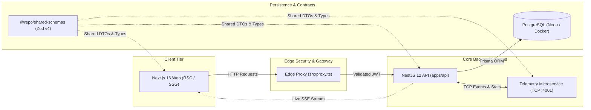

# Greatest Portfolio & Engineering Knowledge Base

[](https://github.com/Kri4evskiy/greatest-portfolio/actions/workflows/ci.yml)


Production-grade Full-Stack monorepo featuring a personal portfolio (styled in **Notion Workfolio** aesthetics) and a protected interactive **Engineering Knowledge Base**, showcasing modern enterprise architecture (`Next.js 16`, `NestJS 12 Native ESM`, `Prisma ORM`, `Microservices TCP + SSE`, `TanStack Query v5 + IndexedDB`, `D3.js`).

---

## 🏗️ Architecture Topology



---

## ⚡ Quick Start (Onboarding in 3 Commands)

The project is built as a unified monorepo powered by **`pnpm workspaces`** ([`pnpm-workspace.yaml`](./pnpm-workspace.yaml)) and **`Turborepo`** ([`turbo.json`](./turbo.json)).
**You do NOT need to navigate into nested directories (`apps/*`, `packages/*`) or install dependencies manually** — a single root command bootstraps all packages across the workspace.

### Prerequisites

- **Node.js:** `>= 22.0.0`
- **pnpm:** `>= 12.x` (`pnpm@12.18.0`, activate via `corepack enable` or `npm install -g pnpm@latest`)

### Option 1: Instant Local Run (Zero Database or Docker Setup Required)

The backend features a resilient `PrismaService` fallback layer: if a local PostgreSQL instance is unavailable, the API automatically falls back to an in-memory store while preserving all `Prisma` contracts, `JWT HttpOnly Cookies`, and real-time `SSE` streaming.

```bash
# 1. Clone the repository
git clone https://github.com/Kri4evskiy/greatest-portfolio.git
cd greatest-portfolio

# 2. Install workspace dependencies in a single step
pnpm install

# (Optional) Explicitly run the setup script (creates .env, builds @repo/shared-schemas, and generates Prisma Client):
# pnpm run setup

# 3. Start all services in parallel (Next.js 16 + NestJS 12 API + Telemetry Microservice)
pnpm run dev
# (The adaptive runner scripts/dev-runner.mjs runs Turborepo, and seamlessly falls back
# to pnpm workspaces if native binaries are blocked, e.g. by Windows Smart App Control)
```

Once running, open in your browser:
- 🌐 **Frontend (Workfolio CV & Knowledge Base):** [http://localhost:3000](http://localhost:3000)
- ⚙️ **Backend API Healthcheck:** [http://localhost:4000/api/health](http://localhost:4000/api/health)
- 📡 **Live SSE Telemetry Stream:** [http://localhost:4000/api/telemetry/stream](http://localhost:4000/api/telemetry/stream)
- 🎨 **UI Kit Storybook (optional standalone command):** `pnpm --filter @repo/ui storybook` ([http://localhost:6006](http://localhost:6006))

---

### Option 2: Full Docker Stack (PostgreSQL 16 + Microservice + API + Web)

To spin up the entire containerized topology including `postgres:16-alpine` and test multi-stage builds (`turbo prune --docker`):

```bash
docker compose up --build -d
```

---

## 🔑 How to Test the Protected Knowledge Base & RBAC (for Team Leads / Recruiters)

1. On the home page [http://localhost:3000](http://localhost:3000), click the **`🔒 Base of Knowledge (Protected • 1-Click)`** button in the header.
2. The **1-Click Guest Pass** modal appears (`React Hook Form` + `Zod` from `@repo/shared-schemas`):
   - Click any fast preset (**`⚡ Alex (Team Lead)`**, **`🎯 Maria (Tech Recruiter)`**, or **`🚀 David (CTO)`**) for instant 1-click access with the `USER` role.
   - Alternatively, expand the _"I am the owner (Admin Passcode)"_ section and enter the demo key: `workfolio-admin-2026` to unlock the `ADMIN` role.
3. The `NestJS` backend signs an HS256 JWT, sets an `HttpOnly, Secure, SameSite=Lax` cookie (`kb_access_token`), publishes a telemetry event to the TCP microservice (`:4001`), updates the footer status over `SSE`, and grants seamless access to `/knowledge-base` (enforced at the Edge via Next.js 16 `src/proxy.ts` and NestJS 12 `JwtRolesGuard`).

---

## 🛠️ Monorepo Commands (Root Directory)

| Command                            | Description                                                                          |
| :--------------------------------- | :----------------------------------------------------------------------------------- |
| `pnpm install`                     | Installs all `apps/*` and `packages/*` dependencies + triggers `setup`               |
| `pnpm run setup`                   | Syncs `.env`, builds `@repo/shared-schemas`, and generates `Prisma Client`           |
| `pnpm run dev`                     | **Adaptive runner:** Turborepo with automatic graceful fallback to `pnpm workspaces` |
| `pnpm run dev:pnpm`                | Force runs all services via `pnpm --parallel` (bypassing `turbo.exe`)                |
| `pnpm run dev:turbo`               | Explicitly runs via `Turborepo` (`turbo run dev`)                                    |
| `pnpm run build`                   | Production build across all packages and apps via `Turborepo`                        |
| `pnpm run build:pnpm`              | Builds the monorepo directly via `pnpm -r build` in topological dependency order     |
| `pnpm run typecheck`               | Strict TypeScript validation (`tsc --noEmit`) across all packages via `Turborepo`    |
| `pnpm run typecheck:pnpm`          | Typechecks packages directly via `pnpm -r typecheck`                                 |
| `pnpm run lint`                    | Blazing fast linting and formatting verification via `Biome.js` (Rust)               |
| `pnpm run lint:fix`                | Automatically fixes linting and formatting issues via `Biome.js`                     |
| `pnpm --filter @repo/ui storybook` | Starts the interactive `Storybook` component showcase on port `6006`                 |

### 🛡️ DX Resilience & Windows Smart App Control (SAC)

Modern Windows 11 installations enforce **Smart App Control (SAC)**, which may block unsigned ecosystem binaries (such as `turbo.exe` inside `@turbo/windows-64`, raising error `spawn UNKNOWN / 0x800711C7`).

The repository is engineered according to the **Zero-Friction Onboarding** principle:
- The `scripts/dev-runner.mjs` script performs a pre-flight probe on Turborepo availability.
- If the system blocks the binary, the runner logs a clear warning and **transparently falls back to native `pnpm workspaces`**, guaranteeing any reviewer or engineer can run the project in a single command on any machine.
- In CI/CD and Docker (Linux), native `Turborepo`, `turbo prune`, and Vercel remote caching operate unconditionally at 100% speed.

---

## 🏛️ Architectural Stack (16 Architecture Decision Records — ADRs)

1. **Monorepo Orchestration:** `pnpm` Workspaces + `Turborepo`
2. **DX & Code Quality:** `TypeScript (Strict)` + `Biome.js` + `Lefthook` (lean `pre-commit` gate preserving caching)
3. **Frontend Platform:** `Next.js 16 (App Router)` — hybrid SSG + SSR + RSC + Edge Proxy (`src/proxy.ts`)
4. **State Separation:** `TanStack Query v5` (server cache) + `Zustand` (client UI state)
5. **Browser Database:** `IndexedDB` (`idb-keyval` + TanStack Query Persister with 24h TTL)
6. **Forms & End-to-End Validation:** `React Hook Form` + `Zod` (`packages/shared-schemas`)
7. **UI System & Documentation:** `Tailwind CSS` + `shadcn/ui` (Radix UI) + `Storybook 10`
8. **Tables & Auto-Memoization:** `TanStack Table` (Tech Radar + ADR) & `React 19 Compiler` (boundary isolation `'use no memo'`)
9. **Content & Visualization:** `MDX` + `WebP` (`<ArticleImageGrid />`) + interactive `D3.js` graphs
10. **Core Backend:** `NestJS 12` (Native ESM, modular DI architecture)
11. **Security:** `JWT` in `HttpOnly Cookies` (`kb_access_token`) + `RBAC` (`GUEST` / `USER` / `ADMIN`)
12. **Database & ORM:** `PostgreSQL` (`Neon.tech` / Docker Postgres) + `Prisma ORM`
13. **Microservices & Real-Time:** `@nestjs/microservices` (`apps/telemetry-ms`, TCP `:4001`) + `Server-Sent Events (@Sse)`
14. **Infrastructure:** `Docker` (Multi-stage builds with `turbo prune`) + `Docker Compose`
15. **Observability:** `Sentry` (Error Tracking) + `PostHog` (Product Analytics)
16. **Localization (i18n):** `next-intl` (App Router RSC, `EN` default + `UA` / `RU`) + colocated `*.{en,uk,ru}.mdx` articles

---

## 📂 Monorepo Structure

```text
greatest-portfolio/
├── .agents/                    # Hierarchical AI context and ADR documentation system
│   ├── tech-debt-backlog.md    # Product backlog, tech debt, and Post-MVP roadmap
│   ├── architecture/           # ADR catalog, CI/CD, shared contracts, Docker & Observability
│   ├── frontend/               # Next.js rules, Workfolio UI, Storybook, State, Auth
│   └── backend/                # NestJS standards, JWT Security, Prisma, Microservices & SSE
├── .github/                    # GitHub Actions CI/CD (ci.yml + setup-workspace composite action)
├── apps/
│   ├── web/                    # Next.js 16 App Router (Workfolio CV + protected Knowledge Base)
│   ├── api/                    # Core NestJS 12 backend (ESM) + Prisma + SSE Stream
│   └── telemetry-ms/           # Telemetry & analytics microservice (@nestjs/microservices)
├── packages/
│   ├── shared-schemas/         # Shared Zod schemas and TypeScript types for web and API (ESM)
│   └── ui/                     # Notion Workfolio UI kit (Tailwind + Radix + Storybook 10)
├── docker/                     # Optimized 3-stage Dockerfiles (turbo prune --docker)
├── scripts/                    # Automation scripts (bootstrap-env.mjs, dev-runner.mjs)
├── AGENTS.md                   # Root AI context router
├── biome.json                  # Unified Rust-based linter and formatter
├── docker-compose.yml          # Container orchestration (postgres + telemetry-ms + api + web)
├── lefthook.yml                # Pre-commit Git hooks (Biome check + Typecheck)
├── pnpm-workspace.yaml         # Monorepo package boundaries and allowBuilds security list
├── tsconfig.base.json          # Root strict TypeScript configuration
└── turbo.json                  # Turborepo task pipeline and caching rules
```

## 🧭 Architecture Documentation Navigation

- [Root AI Context Router (`AGENTS.md`)](./AGENTS.md)
- [Tech Debt & Post-MVP Roadmap (`.agents/tech-debt-backlog.md`)](./.agents/tech-debt-backlog.md)
- [Full Catalog of 16 ADRs: Why, Where & How (`.agents/architecture/adr-stack.md`)](./.agents/architecture/adr-stack.md)
